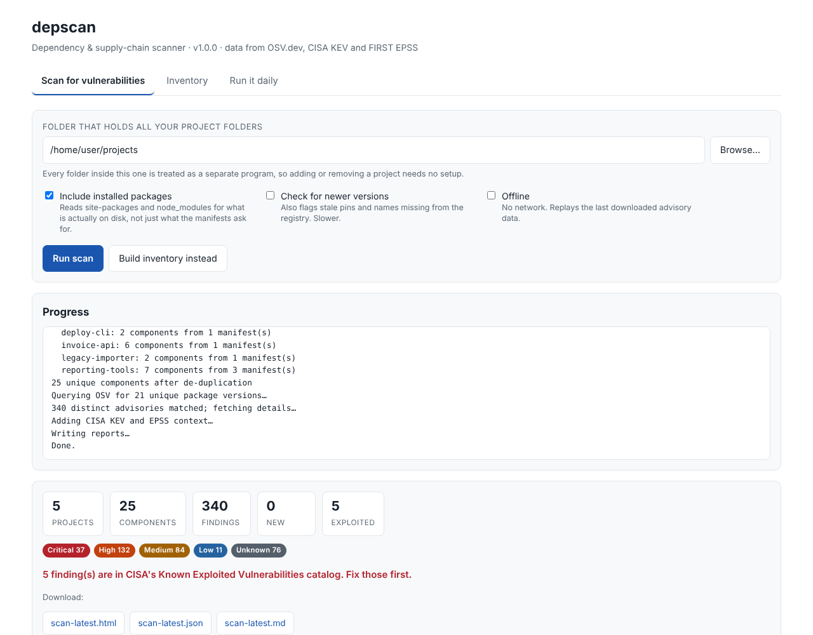

# depscan

Point it at the one folder that holds all your projects. It finds every
third-party package, action and image those projects pull in, checks each one
against published security advisories, and tells you what to fix first.

**New here? Read [QUICKSTART.txt](QUICKSTART.txt) instead — it assumes nothing.**

## Install and run

Requires **Python 3.11 or newer**, and nothing else. No accounts, no API keys,
no packages to install.

### Point and click

| | |
|---|---|
| **macOS** | Double-click `Start depscan (macOS).command`. The first time, macOS blocks files downloaded from the internet — right-click → Open → confirm. Once only. |
| **Windows** | Double-click `Start depscan (Windows).bat` |
| **Linux** | `./start-depscan-linux.sh` |

Your browser opens with the interface. The terminal window that appears *is*
the program — leave it open while you work, close it to stop.



### From a terminal

```bash
python3 -m depscan gui                             # the same interface
python3 -m depscan scan --root ~/projects          # the daily check
python3 -m depscan inventory --root ~/projects     # "what am I running?"
python3 -m depscan sources                         # where the security data comes from
```

### Installed properly

```bash
pip install .
depscan gui
```

---

No dependencies to install — Python 3.11+ and the standard library only. That
is deliberate: a tool whose job is policing your supply chain should not widen
it. No API keys, no accounts, no data leaves your machine except package
*names and versions* sent to the public advisory APIs.

### A note on the web interface

It binds to `127.0.0.1` only, so nothing outside your machine can reach it,
and every request must carry a random key minted at startup and embedded in
the URL that opens. Without that key, another program on your machine — or a
web page you happen to have open — could otherwise drive the scanner. The
`Host` header is checked too, which is what stops a DNS-rebinding attack from
turning a visited page into a client. Downloads are confined to the report
folder.

---

## Where the security information comes from

This was the open question, so here is the answer in full.

### Primary source: OSV.dev

**[OSV.dev](https://osv.dev)** — run by Google's Open Source Security Team.
Free, open source, no API key.

The important thing about OSV is that it is **not another opinion** about
which versions are vulnerable. It is the aggregation layer over the databases
each language community maintains for itself:

| Feeding database | Covers |
|---|---|
| GitHub Advisory Database | npm, PyPI, Maven, NuGet, Go, RubyGems, Composer, crates.io, GitHub Actions |
| PyPA Advisory Database | Python (`PYSEC-` records) |
| RustSec | Rust crates |
| Go Vulnerability Database | Go modules |
| ~20 more | Linux distributions, Android, OSS-Fuzz, Haskell, Bitnami… |

The reason it is the right primary source for *this* job is the data shape.
Every OSV advisory carries machine-readable **affected version ranges**, so
"is the version I actually have affected?" gets an exact answer instead of a
guess parsed out of prose. A CVE description alone cannot do that.

### Prioritisation: CISA KEV

**[CISA Known Exploited Vulnerabilities](https://www.cisa.gov/known-exploited-vulnerabilities-catalog)**
— the US Cybersecurity and Infrastructure Security Agency's catalogue of flaws
**observed being exploited in real attacks**. This is evidence, not prediction.
US federal agencies are required to remediate these under Binding Operational
Directive 22-01.

depscan sorts KEV findings to the very top, above anything else, including
higher-scoring vulnerabilities that nobody is actually attacking.

### Prioritisation: FIRST EPSS

**[EPSS](https://www.first.org/epss)**, from FIRST — the same organisation that
stewards the CVSS scoring standard. It gives every CVE a daily-updated
probability (0–100%) of being exploited in the next 30 days.

CVSS tells you *how bad it would be*. EPSS tells you *how likely it is*. A 9.8
with a 0.3% EPSS can usually wait; a 7.5 at 97% cannot. Both are shown.

### Why not NVD directly?

[NVD](https://nvd.nist.gov) is authoritative for CVE records and much of this
data ultimately traces back to it. depscan does not query it directly because
its API is heavily rate-limited, it has carried a well-documented enrichment
backlog since 2024, and its CPE-based version matching is far less reliable for
language packages than OSV's explicit ranges. OSV already incorporates CVE
data, so going direct adds latency without adding trust.

All three sources are public, free, and need no account. Advisories are cached
locally, so repeat runs are fast and `--offline` still works.

---

## The workflow you asked for

```
~/projects/                 <- point depscan here, once
  budget-game/
  invoice-tool/
  client-work/scraper/
  ...
```

Every immediate subdirectory is treated as one program. **Add or remove a
project and the next run picks it up with no config change.**

### 1. The daily check

```bash
python3 -m depscan scan --root ~/projects
```

Reports what is vulnerable, worst first, and what is **new since the last
run** — so the daily mail is "3 new findings", not the same 300 every morning.

Exits `0` when clean and `1` when something at or above `--fail-on` (default
`high`) was found. That exit code is a complete notification channel on its
own: cron emails you the output of any job that exits non-zero.

### 2. The manual inventory

```bash
python3 -m depscan inventory --root ~/projects
```

Lists **everything** in use and where it came from — package, exact version,
ecosystem, whether you asked for it directly or something else dragged it in,
which file declares it, and a link to its page on the registry it was
downloaded from. Each project is listed with its git remote, branch and commit,
so "where did this program come from?" is answered too.

Writes three files:

- `inventory-latest.md` — readable, grouped by project
- `inventory-latest.csv` — for a spreadsheet
- `inventory-latest.cdx.json` — a **CycloneDX SBOM**, the standard format other
  security tools and auditors can ingest

Add `--check-updates` to also ask PyPI/npm/crates.io for the newest release of
each package. That flags stale pins, and also names that **no longer exist on
the registry** — worth checking for typos and dependency confusion.

### 3. Running it daily

```bash
python3 -m depscan schedule --root ~/projects --time 07:30
```

prints the exact setup for cron, systemd, launchd, Windows Task Scheduler and
GitHub Actions. Add `--install-cron` to have the crontab entry written for you.
Ready-made unit files are in [`scripts/`](scripts/).

---

## What it finds

| Ecosystem | Read from |
|---|---|
| Python | `requirements*.txt` (including `-r` includes), `pyproject.toml` (PEP 621 + Poetry), `poetry.lock`, `Pipfile.lock`, `setup.py`, `setup.cfg`, `environment.yml`, **installed `site-packages`** |
| JavaScript | `package.json`, `package-lock.json`, `yarn.lock`, `pnpm-lock.yaml`, **installed `node_modules`** |
| Go | `go.mod` |
| Rust | `Cargo.lock` |
| Ruby | `Gemfile.lock` |
| Java | `pom.xml` |
| .NET | `*.csproj`, `packages.config` |
| PHP | `composer.lock` |
| GitHub Actions | `.github/workflows/*.yml` |
| Git | submodules, `git+` dependencies, each project's own remote |
| Containers | `Dockerfile` base images *(inventory only — OSV does not index images)* |

Lockfiles and installed packages are preferred over loose manifests, because
only they pin the exact version an advisory can be matched against. Anything
left unpinned is reported as such rather than quietly skipped.

### A note on GitHub Actions

OSV holds GitHub Actions advisories but **does not resolve versions for that
ecosystem server-side** — querying `tj-actions/changed-files@45.0.7` returns
nothing even though an advisory fixed in `46.0.1` exists. depscan fetches those
advisories unversioned and matches the ranges itself, so the compromised-action
case (how the March 2025 `tj-actions` incident reached thousands of repos) is
actually caught. See `CLIENT_SIDE_MATCH` in `depscan/osv.py`.

A step pinned to a mutable tag like `@v4` runs whatever that tag points at
today. Pinning actions to a full commit SHA is the fix; depscan shows you which
ones are not.

---

## Accepting a risk

Some findings you will decide not to act on. Record that decision in
`depscan.toml` rather than in your head:

```toml
[[ignore]]
id = "GHSA-xxxx-xxxx-xxxx"
package = "requests"
reason = "Not reachable — we never pass a proxy URL. Revisit at the Q1 upgrade."
expires = "2027-03-31"
```

`expires` is strongly encouraged: after that date the finding comes back on its
own, so an accepted risk gets revisited instead of becoming permanent. A
malformed date is treated as already expired — a typo must never silently hide
a vulnerability.

---

## Options worth knowing

| Flag | Effect |
|---|---|
| `--root PATH` | the folder holding your projects |
| `--port N` | *(gui)* local port, default 8765 |
| `--no-browser` | *(gui)* print the URL instead of opening a browser |
| `--format` | `markdown`, `html`, `json`, `csv`, `cyclonedx` (repeatable) |
| `--fail-on` | `critical`/`high`/`medium`/`low`/`never` — exit-code threshold |
| `--only-new` | fail only on findings not seen in a previous run |
| `--offline` | no network; replays the cached results and says how stale they are |
| `--no-installed` | skip `site-packages`/`node_modules` for a faster manifest-only run |
| `--check-updates` | also flag outdated and missing-from-registry packages |
| `--webhook URL` | POST a JSON summary (the `text` field renders in Slack/Teams) |
| `--exclude NAME` | skip a directory name (repeatable) |

Config file: copy `depscan.example.toml` to `depscan.toml`, or to
`~/.config/depscan/config.toml`, and the daily job becomes a bare
`depscan scan`.

---

## Honest limits

- **It reads manifests; it does not resolve dependency trees.** A range like
  `^4.17.0` with no lockfile cannot be matched against an advisory. depscan
  counts those and tells you — commit lockfiles to close the gap.
- **Transitive coverage is only as deep as your lockfiles.** `pom.xml` and
  `package.json` without a lockfile give you direct dependencies only.
- **Container images are inventoried, not scanned.** OSV does not index image
  contents; use Trivy or Grype if you need that.
- **A clean report means "nothing published against these versions"**, not
  "safe". Zero-days are by definition absent, and vendored or copy-pasted code
  has no manifest to read.
- **CVSS v4 vectors are not scored**, as that equation is a lookup-table
  design; those advisories fall back to the publisher's severity label.

## What is in this folder

| Path | |
|---|---|
| `QUICKSTART.txt` | start here if you just want to run it |
| `Start depscan (…)` | double-click launchers for macOS, Windows, Linux |
| `depscan/` | the program itself |
| `depscan/web.py` | the browser interface |
| `scripts/` | ready-made cron, systemd, launchd and GitHub Actions setups |
| `depscan.example.toml` | copy to `depscan.toml` to save your settings |
| `tests/` | the test suite |

## Tests

```bash
python3 -m unittest discover -s tests -v
```

42 tests, no network access required.
